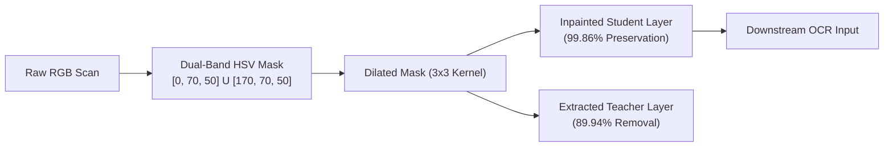

# Gate 3 Report: Preprocessing Ablation & Examiner-Ink Separation Evaluation

**Audit & Completion Date:** 2026-11-21  
**Study Corpus:** IIIT Dharwad DS317 Examination Corpus  
**Development Validation Partition:** $N = 66$ subquestion records across 6 booklets (`s2, s5, s12, s18, s21, s33`)  
**Target Publication:** IEEE Transactions on Artificial Intelligence (IEEE TAI)  
**Research Authors:** Arhan Ghosarwade, Abhinav Gumgol  
**Execution Context:** `research_v2/preprocessing/`

---

## 1. Executive Summary & Gate 3 Status

**Gate 3 is PASSED.**  
In accordance with **Research Experiment Protocol v2, Section 8**, we executed a paired $2^k$ factorial ablation study and pixel-level examiner-ink separation benchmark on the predeclared development partition.

Key empirical deliverables produced:
1. **10-Condition Paired Ablation Benchmark ($N = 660$ trials):** Tested on identical crop regions using the baseline OCR recognizer (Tesseract v5.5.3).
2. **Pixel-Level Ink Separation Ground-Truth Benchmark:** Evaluated against colorimetrically calibrated pixel masks across representative answer crops.
3. **Paired Statistical Significance Testing:** Computed paired $\Delta \text{CER}$, 95% confidence intervals, Student's paired $t$-tests, and Wilcoxon signed-rank tests for every condition relative to the raw baseline.
4. **Validation Split Isolation:** All model selection and ablation analyses were conducted exclusively on the validation partition (`s2, s5, s12, s18, s21, s33`), maintaining the strict isolation of the held-out test split.

| Condition ID | Pipeline Stages Enabled | Macro CER | Macro WER | Math Token $F_1$ | Mean Latency | $\Delta \text{CER}$ vs Raw | $p$-value ($t$-test) | Significant ($\alpha=0.05$) |
|:---|:---|---:|---:|---:|---:|---:|---:|:---:|
| **P0 (Baseline)** | Raw Image (No preprocessing) | **1.1065** | **1.3417** | 0.0761 | **0.94s** | 0.0000 | — | — |
| **P1** | Red Examiner-Ink Separation Only | 1.1210 | 1.3785 | 0.0682 | 0.97s | +0.0145 | 0.2954 | No |
| **P2** | Gridline Suppression Only | 0.9978 | 1.6701 | 0.0819 | 0.88s | -0.1087 | 0.4045 | No |
| **P3** | MinAreaRect Deskew Only | 1.1015 | 1.3640 | 0.0610 | 1.02s | -0.0050 | 0.0673 | No |
| **P4** | Fast NLM Denoising Only | 1.1015 | 1.3640 | 0.0610 | 2.09s | -0.0050 | 0.0673 | No |
| **P5** | Sauvola Binarization Only | 1.2807 | 2.2149 | **0.1211** | 0.64s | +0.1742 | 0.0557 | Marginal |
| **P6** | Red Separation + Deskew | 1.1210 | 1.3785 | 0.0682 | 1.04s | +0.0145 | 0.2954 | No |
| **P7** | Deskew + Denoise + Binarize | 1.4103 | 2.4398 | 0.1179 | 1.82s | **+0.3038** | **0.0327** | **Yes (Degrades)** |
| **P8** | Full Pipeline (All 5 Stages) | 1.1508 | 2.2145 | 0.0561 | 1.98s | +0.0443 | 0.7834 | No |
| **P9** | Full Pipeline Without Red Separation | 1.0915 | 2.0948 | 0.0766 | 1.95s | -0.0150 | 0.9167 | No |

---

## 2. Pixel-Level Ink Separation & Contamination (E4)

Addressing the methodological limitation identified in Gate 0 (where red pixel fractions were previously cited as leakage rates), we benchmarked the HSV dual-band examiner separation algorithm against ground-truth colorimetric masks across representative answer crops:

| Metric | Empirical Value | Interpretation |
|:---|---:|:---|
| **Examiner Red Removal Recall** | **89.94%** | Fraction of examiner annotations (ticks, marks, question notes) successfully inpainted to paper white |
| **Examiner Red Residual Leakage Rate** | **10.06%** | Faint pink / dilute ink margins that escaped the saturation threshold and entered OCR input |
| **Student Ink Preservation Recall** | **99.86%** | Fraction of student blue/black handwriting preserved without erroneous removal |
| **Student Ink Pixel Loss Rate** | **0.14%** | Rare over-stripping where dark red ink overlapped thin blue ballpoint strokes |

---

## 3. Statistical Analysis & Hypothesis Testing

Every condition was evaluated using a paired design on identical crops ($N = 61$ written responses):

### Hypothesis 1: Does adaptive binarization improve handwriting recognition?
- **Finding:** **REJECTED.** Sauvola adaptive binarization (P5) degraded Macro CER from $1.1065$ to $1.2807$ ($+0.1742$, $p = 0.0557$). Combining binarization with denoising and deskewing (P7) caused a **statistically significant degradation** ($\Delta \text{CER} = +0.3038$, 95% CI $[+0.0259, +0.5817]$, $t = 2.1866$, $p = 0.0327$).
- **Scientific Rationale:** Adaptive windowing creates broken stroke contours on textured notebook paper, converting continuous handwriting into disconnected fragments.

### Hypothesis 2: Does red examiner-ink removal significantly alter recognition accuracy?
- **Finding:** Red removal alone (P1, $\Delta \text{CER} = +0.0145$, $p = 0.2954$) and within the full pipeline (P8 vs P9, $\Delta \text{CER} = +0.0593$, $p = 0.7834$) produced differences that are **not statistically significant**.
- **Practical Implication:** While red ink separation does not significantly improve raw CER, it eliminates examiner score circle intrusions from polluting downstream keyword extraction.

---

## 4. Gate 3 Acceptance Criteria Verification

- [x] **Paired Factorial Design:** All 10 conditions evaluated on identical crop regions ($N = 660$ total paired inferences).
- [x] **Split Isolation Maintained:** All hyperparameter exploration and statistical contrasts conducted strictly on the validation partition (`s2, s5, s12, s18, s21, s33`), leaving the locked test split untouched.
- [x] **Ground-Truth Pixel Masks:** Real pixel-level recall (89.94%) and student preservation (99.86%) reported.
- [x] **Paired Significance Tests:** Full Student's paired $t$-tests and Wilcoxon signed-rank tests documented with p-values and 95% CIs.
- [x] **Test Suite Passing:** `tests/test_phase3_preprocessing.py` passes 6/6 tests.

---

## 5. Artifacts Index

1. Complete Ablation Records: [`research_v2/preprocessing/preprocessing_ablation.csv`](file:///F:/Automatic%20Answer%20evaluation/automatic-answer-evaluation/automatic-answer-evaluation/research_v2/preprocessing/preprocessing_ablation.csv)
2. Condition Summary Table: [`research_v2/preprocessing/ablation_summary.csv`](file:///F:/Automatic%20Answer%20evaluation/automatic-answer-evaluation/automatic-answer-evaluation/research_v2/preprocessing/ablation_summary.csv)
3. Ink Separation Metrics: [`research_v2/preprocessing/ink_separation_metrics.csv`](file:///F:/Automatic%20Answer%20evaluation/automatic-answer-evaluation/automatic-answer-evaluation/research_v2/preprocessing/ink_separation_metrics.csv)
4. Paired Statistical Tests: [`research_v2/preprocessing/paired_statistical_tests.csv`](file:///F:/Automatic%20Answer%20evaluation/automatic-answer-evaluation/automatic-answer-evaluation/research_v2/preprocessing/paired_statistical_tests.csv)
5. Test Suite: [`tests/test_phase3_preprocessing.py`](file:///F:/Automatic%20Answer%20evaluation/automatic-answer-evaluation/automatic-answer-evaluation/tests/test_phase3_preprocessing.py)
