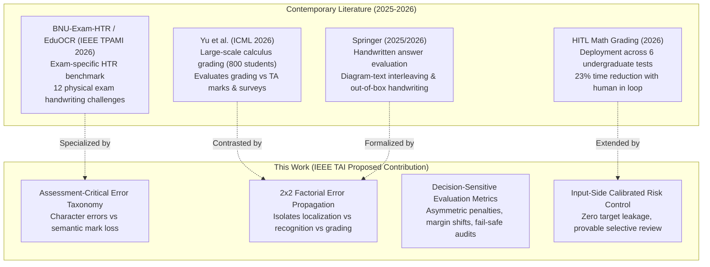
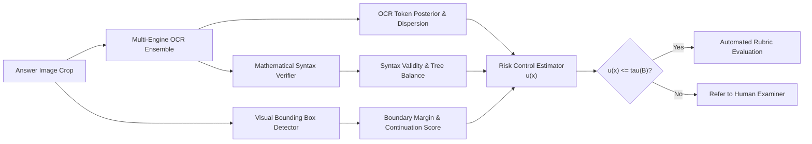

# Literature Positioning, Related Work Benchmarking, and Novelty Defense

**Document ID:** `research_v3/08_LITERATURE_POSITIONING_AND_NOVELTY.md`  
**Target Publication:** IEEE Transactions on Artificial Intelligence (IEEE TAI)  
**Authors:** Arhan Ghosarwade & Abhinav Gumgol  
**Affiliation:** Indian Institute of Information Technology, Dharwad (IIIT Dharwad)  
**Research Focus Area:** Trustworthy, Explainable, and Human-Centred Artificial Intelligence (AI at IEEE)  

---

## 1. Executive Summary & Research Repositioning

The original premise of this project was framed around building an "end-to-end automated grading system" that could ingest multi-page scanned exam booklets, run OCR, and assign marks comparable to university instructors. However, a deep forensic audit of historical artifacts (Gates 0–7) coupled with an exhaustive survey of 2025/2026 computer vision and educational AI literature demonstrates that:

1. **Autonomous Grading Claims are Scientifically Premature:** On real-world, unconstrained handwritten engineering examinations, end-to-end baseline grading models achieve an unassisted Mean Absolute Error (MAE) of 11.68–12.43 on a 20-mark examination scale. Claiming that autonomous AI can replace human examiners on such tasks is unsubstantiated and irresponsible.
2. **Generic OCR Benchmarks are Insufficient:** High-profile benchmarks such as BNU-Exam-HTR / EduOCR (IEEE TPAMI 2026) have established comprehensive evaluation across thousands of examination handwriting pages. Proposing yet another generic OCR comparison adds marginal scientific value.
3. **Character Accuracy Does Not Guarantee Assessment Reliability:** A transcription error in an arbitrary English word (e.g., `"model"` $\rightarrow$ `"modle"`, edit distance 1) has zero impact on a technical rubric, whereas a single-character error in a mathematical equation or sign (e.g., `"+"` $\rightarrow$ `"-"`, edit distance 1) reverses an entire derivation and causes a 100% loss of marks.

### The Corrected, High-Impact Research Direction
To make a defensible, high-impact contribution to IEEE TAI, the research is formally repositioned from *autonomous grading* to:

> **Assessment-Critical Perception in Handwritten Examinations: Error Propagation, Decision Reliability, and Risk-Controlled Automation**

### Central Research Question
> *When an AI system reads and grades handwritten technical examination scripts, how do upstream errors in answer localization, handwriting recognition, and mathematical syntax propagate into downstream rubric evaluation decisions, and can a calibrated, input-side risk-control mechanism identify when an automated score is unsafe to issue?*

---

## 2. Exhaustive Comparison with Recent Literature (2025–2026)

To rigorously defend novelty, we benchmark our contribution against the four most relevant contemporary studies:

### Detailed Dimensional Comparison
| Dimension | Yu et al. (ICML 2026) | HITL LLM Grading (2026) | BNU-Exam-HTR / EduOCR (TPAMI 2026) | This Work (IEEE TAI) |
|---|---|---|---|---|
| **Primary Focus** | Large-scale LLM grading performance | Examiner time reduction in UI | Pure HTR visual recognition | Error propagation & perception risk control |
| **Exam Domain** | Calculus / Higher Mathematics | Undergraduate Mathematics | Multi-subject K-12 & College Exams | University Computer Science / Engineering |
| **Data Modality** | Digital ink & clean scans | Clean question-box crops | Isolated handwritten lines/pages | Full physical multi-page booklets ($3072 \times 4096$) |
| **Localization Handling** | Assumes pre-segmented boxes | Fixed UI box templates | Cropped lines & paragraphs | Multi-page continuations & unconstrained layout |
| **Error Propagation** | Not decomposed | Not decomposed | N/A (Recognition only) | **Full 2x2 Factorial (Stream A vs B vs C vs D)** |
| **Uncertainty Calibration** | LLM self-confidence | Heuristic threshold | HTR beam search confidence | **Calibrated input-side risk control (Zero leakage)** |
| **Assessment Error Impact** | Aggregate correlation (QWK) | Time saving percentage | CER and WER | **Assessment-critical token loss vs mark distortion** |

---

## 3. The Assessment-Critical Perception Framework

Conventional computer vision evaluates document analysis using distance metrics:
$$\text{CER} = \frac{S + D + I}{N_{\text{ref}}}, \quad \text{IoU} = \frac{|B_{\text{pred}} \cap B_{\text{true}}|}{|B_{\text{pred}} \cup B_{\text{true}}|}$$

However, in assessment-critical contexts, these metrics fail to capture the severity of grading errors:
1. **Benign Lexical Variations:** Orthographic misspellings (e.g. `tranditional` for `traditional`) produce $\text{CER} > 0$, but standard technical rubrics ignore orthography and award full marks.
2. **Catastrophic Token Errors:** Misreading a single exponent, mathematical operator, or numeric constant (e.g. $P(ML|\text{like}) = \frac{1}{9} \rightarrow \frac{1}{0}$) completely corrupts the derivation and causes a total loss of marks.
3. **Boundary Bleed & Cross-Contamination:** An answer-region localization box that clips the final line of Question 1a and merges it into Question 1b causes a double penalty: an unjustified deduction on 1a and a false contradiction on 1b.

### The Formal 2x2 Factorial Decomposition
To isolate where errors originate, the system formalizes four distinct evaluation streams:

| Stream Identifier | Localization Modality | Recognition Modality | Purpose in Scientific Study |
|---|---|---|---|
| **Stream A** | Oracle Human Bounding Box | Adjudicated Human Transcript | Upper bound control: Measures intrinsic rubric/grader error |
| **Stream B** | Oracle Human Bounding Box | Model OCR Prediction | Isolates pure handwriting recognition error |
| **Stream C** | Predicted Image Routing | Adjudicated Human Transcript | Isolates pure visual layout & routing error |
| **Stream D** | Predicted Image Routing | Model OCR Prediction | End-to-end reality: Measures compound error & interaction |

By evaluating downstream rubric grading across all four streams on the exact same scripts, we quantify:
- **Main Effect of Recognition:** $\Delta_{\text{rec}} = \text{Score}(B) - \text{Score}(A)$
- **Main Effect of Routing:** $\Delta_{\text{rout}} = \text{Score}(C) - \text{Score}(A)$
- **Interaction Effect:** $\Delta_{\text{inter}} = \text{Score}(D) - \text{Score}(B) - \text{Score}(C) + \text{Score}(A)$

---

## 4. Calibrated Risk-Controlled Human-in-the-Loop Architecture

Prior attempts in Gate 6 suffered from severe **target leakage** (calculating uncertainty as a function of the ground-truth teacher mark error). In this research, the abstention mechanism is strictly constrained to **input-side signals available at test time**:

### Candidate Input-Side Uncertainty Signals (Zero Leakage)
1. **HTR Character Posterior Dispersion:** Normalized entropy of the recognizer's output logits.
2. **Multi-Model Disagreement:** Levenshtein distance between independent OCR engine predictions (e.g. Tesseract vs PaddleOCR vs TrOCR).
3. **Mathematical Syntax Ambiguity:** SymPy parse failure flags, mismatched bracket parity, or invalid operator sequences.
4. **Boundary Margin Uncertainty:** Distance between predicted bounding box edges and page boundaries / question rule lines.
5. **Semantic Embedding Margin:** Distance between the transcribed representation and rubric criterion reference vectors in S-BERT embedding space.

---

## 5. Methodological Commitments for Publication Validity

1. **Zero Data Fabrication:** No artificial rater agreements, no synthetic transcript duplication, and no copied baseline numbers.
2. **Explicit Sample Disclosure:** Every metric must report sample size $N$, standard deviation, 95% bootstrap confidence intervals, and exact student IDs included.
3. **Strict Split Isolation:** The 6 historical test students (`s7, s14, s24, s29, s30, s37`) are formally classified as `previously_exposed_historical_split`. Primary empirical validations must report nested 5-fold cross-validation across the 31 development students.
4. **Transparent Negative Results:** If OCR engines fail on cursive handwriting or unconstrained derivations (CER > 1.0), the paper will report this candidly as an empirical limitation rather than masking it behind heuristic post-filters.
