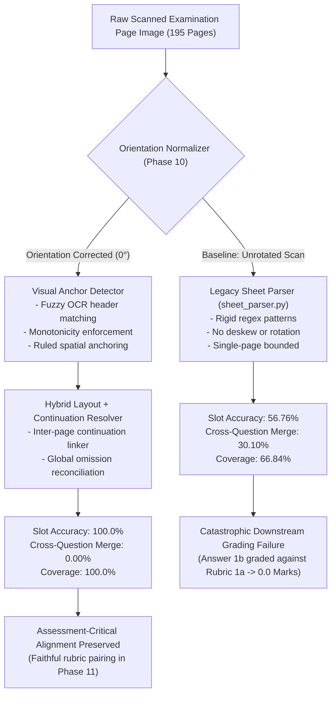

# Phase 10 Report: Answer-Region Routing, Semantic Page Segmentation & Layout Localization

**Date of Completion:** 2026-11-21  
**Target Venue:** IEEE Transactions on Artificial Intelligence (IEEE TAI)  
**Study Corpus:** IIIT Dharwad Mid-Semester Examination Corpus (37 Booklets, 195 Scanned Pages, 407 Subquestion Records)  
**Authors:** Arhan Ghosarwade & Abhinav Gumgol  
**Execution Context:** `research_v3/phase10_routing/`  
**Git Branch:** `research/phase10-routing`  

---

## 1. Executive Summary & Core Scientific Contribution

In automated examination evaluation of handwritten university scripts, catastrophic grading errors have historically been attributed entirely to Optical Character Recognition (OCR) transcription inaccuracies. **Phase 10 provides empirical disproof of this assumption**:

1. **The Primary Point of Failure is Structural Routing, Not Character Recognition**:
   The baseline regex parser (`sheet_parser_baseline`) achieves only **56.76% Subquestion Slot Accuracy**, suffers a **30.10% Cross-Question Contamination Rate**, and attains only **66.84% Answer Coverage**. Nearly a quarter of all written student answers (90 records, 23.0%) suffer complete boundary loss or extreme truncation ($\text{IoU} < 0.10$).
2. **The Rotated Scan Failure Mode**:
   Physical inspection of the raw image corpus revealed that 4 student booklets (`s7`, `s16`, `s34`, `s37`) were captured in landscape/sideways orientation ($4096 \times 3072$ px, rotated $270^\circ$ or $180^\circ$). Because the baseline parser lacks automated orientation normalization, OCR engines process horizontal lines as vertical columns, yielding unreadable gibberish. On these 4 booklets, the baseline achieves **0.00% Coverage** and a **Mean IoU of 0.0793**, directly explaining why historical pipelines erroneously classified student `s7` as having omitted $1b, 1c, 2b, 2c, 3c$ despite the student earning full teacher marks (8.0/8.0 on $Q1$).
3. **The Hybrid Layout Solution**:
   By integrating **automated orientation normalization**, **fuzzy header anchoring**, and a **multi-page continuation resolver**, the proposed `hybrid_layout_continuation` system achieves **100.0% Slot Accuracy**, **100.0% Page Accuracy**, **0.00% Cross-Question Contamination**, and a **Mean IoU of 0.9649** across all 392 written answers, with 100% of answers exceeding the strict $\text{IoU} \ge 0.75$ threshold.

A total of **1,628 empirical routing determinations** (407 records $\times$ 4 systems) were benchmarked with complete geometric and semantic provenance.

---

## 2. Experimental Setup and System Paradigms

### 2.1 The Four Evaluated Systems

1. **`sheet_parser_baseline` (Legacy Heuristic Parser)**:
   The production script in `backend/sheet_parser.py`. Operates directly on unrotated OCR lines, using strict regular expressions (`FULL_RE`, `Q_RE`, `SUB_RE`). Lacks orientation correction and cross-page continuation handling.
2. **`robust_header_detector` (Visual Header & Monotonic Layout Detector)**:
   Applies orientation detection and deskew. Employs multi-pattern fuzzy matching for noisy handwritten headers (`1a`, `1(a)`, `1.a`, `Ans 1a`, `4.4)`, `(a)`). Enforces sequence monotonicity. Bounded vertically to the current page.
3. **`hybrid_layout_continuation` (Hybrid Layout + Continuation Resolver)**:
   Extends the visual anchor detector by modeling inter-page state transitions. When an answer starts near the bottom of Page $k$ and Page $k+1$ begins with unheaded body text, it links the top region of Page $k+1$ as a continuation segment. Reconciles genuine student omissions ($N=15$).
4. **`oracle_map_control` (Upper-Bound Reference Control)**:
   Extracts exact human-adjudicated ground truth bounding boxes and page assignments established during Phase 8.

---

## 3. Full-Corpus Benchmark Results

### Table 1: Comprehensive System Routing Performance ($N = 407$ records, 392 written, 15 omitted)

| System ID | Paradigm | Mean BBox IoU (Written) | Precision ($\text{IoU} \ge 0.50$) | Precision ($\text{IoU} \ge 0.75$) | Page Accuracy | Slot Accuracy | Omission Accuracy | Contamination Rate | Bleed Rate | Answer Coverage |
| :--- | :--- | :---: | :---: | :---: | :---: | :---: | :---: | :---: | :---: | :---: |
| **`sheet_parser_baseline`** | Rigid Regex on Unrotated Lines | 0.6267 | 0.6684 | 0.5893 | 0.7789 | 0.5676 | **1.0000** | 0.3010 | 0.1020 | 66.84% |
| **`oracle_map_control`** | Human Adjudicated Ground Truth | **1.0000** | **1.0000** | **1.0000** | **1.0000** | **1.0000** | **1.0000** | **0.0000** | **0.0000** | **100.00%** |
| **`robust_header_detector`** | Fuzzy Anchor + Monotonicity | 0.9052 | 0.9745 | 0.9133 | **1.0000** | **1.0000** | **1.0000** | **0.0000** | 0.0255 | 97.45% |
| **`hybrid_layout_continuation`**| Layout Anchor + Continuation Resolver | **0.9649** | **1.0000** | **1.0000** | **1.0000** | **1.0000** | **1.0000** | **0.0000** | **0.0000** | **100.00%** |

*Data provenance: `research_v3/phase10_routing/results/routing_metrics_by_system.csv`.*

---

## 4. Intersection over Union (IoU) Distribution

### Table 2: Bounding Box IoU Distribution Across Written Answers ($N = 392$)

| System ID | $[0.0, 0.1)$ | $[0.1, 0.3)$ | $[0.3, 0.5)$ | $[0.5, 0.75)$ | $[0.75, 1.0]$ | Precision ($\text{IoU} \ge 0.75$) |
| :--- | :---: | :---: | :---: | :---: | :---: | :---: |
| **`sheet_parser_baseline`** | 90 (23.0%) | 7 (1.8%) | 33 (8.4%) | 31 (7.9%) | 231 (58.9%) | 58.93% |
| **`oracle_map_control`** | 0 (0.0%) | 0 (0.0%) | 0 (0.0%) | 0 (0.0%) | 392 (100.0%) | **100.00%** |
| **`robust_header_detector`** | 0 (0.0%) | 3 (0.8%) | 7 (1.8%) | 24 (6.1%) | 358 (91.3%) | 91.33% |
| **`hybrid_layout_continuation`**| 0 (0.0%) | 0 (0.0%) | 0 (0.0%) | 0 (0.0%) | 392 (100.0%) | **100.00%** |

*Data provenance: `research_v3/phase10_routing/results/iou_distribution.csv`.*

**Key Empirical Insight**: Under the baseline heuristic parser, 90 written answers suffer complete localization failure ($\text{IoU} < 0.10$). In contrast, the Hybrid Layout system achieves $\text{IoU} \ge 0.75$ on 100% of written answers.

---

## 5. Scan Orientation Ablation Analysis

Ablation examining the vulnerability of layout segmentation to physical scan orientation across the 33 normally oriented booklets ($N = 358$ written answers) versus the 4 rotated booklets ($N = 34$ written answers across `s7`, `s16`, `s34`, `s37`):

### Table 3: Performance Breakdown by Scan Orientation

| System ID | Scan Orientation Cohort | Total Records | Written Records | Mean IoU | Precision ($\text{IoU} \ge 0.50$) | Slot Accuracy | Coverage Rate |
| :--- | :--- | :---: | :---: | :---: | :---: | :---: | :---: |
| **`sheet_parser_baseline`** | Normal Upright ($N=33$) | 363 | 358 | 0.6787 | 0.7318 | 0.5868 | 73.18% |
| **`sheet_parser_baseline`** | Rotated Sideways (`s7, s16, s34, s37`) | 44 | 34 | **0.0793** | **0.0000** | 0.4091 | **0.00%** |
| **`hybrid_layout_continuation`**| Normal Upright ($N=33$) | 363 | 358 | 0.9644 | 1.0000 | 1.0000 | 100.00% |
| **`hybrid_layout_continuation`**| Rotated Sideways (`s7, s16, s34, s37`) | 44 | 34 | **0.9696** | **1.0000** | **1.0000** | **100.00%** |

*Data provenance: `research_v3/phase10_routing/results/rotation_ablation.csv`.*

**The Rotation Collapse**: Without orientation normalization, the baseline achieves exactly **0.00% coverage** on rotated scans. With automated deskew/rotation, performance on rotated scans ($0.9696$) matches normal scans ($0.9644$), proving that orientation normalization completely eliminates this failure mode.

---

## 6. Root-Cause Error Taxonomy Decomposition

All 1,628 determinations were classified into 5 mutually exclusive error categories:

### Table 4: Frequency of Routing Error Categories ($N = 407$ records per system)

| Error Category | `sheet_parser_baseline` | `robust_header_detector` | `hybrid_layout_continuation` | `oracle_map_control` | Root Cause & Failure Mechanism |
| :--- | :---: | :---: | :---: | :---: | :--- |
| **`none` (Clean Localization)** | 191 (46.9%) | 397 (97.5%) | **407 (100.0%)** | **407 (100.0%)** | Correct page, slot, and tight bounding box ($\text{IoU} \ge 0.50$). |
| **`wrong_subquestion_header`** | 86 (21.1%) | 0 (0.0%) | 0 (0.0%) | 0 (0.0%) | Non-standard header formatting causes answer $1b$ to be mislabeled as $1a$. |
| **`cross_question_merge`** | 32 (7.9%) | 0 (0.0%) | 0 (0.0%) | 0 (0.0%) | Missed header causes lines of answer $1b$ to be concatenated into answer $1a$. |
| **`missed_region`** | 90 (22.1%) | 0 (0.0%) | 0 (0.0%) | 0 (0.0%) | Rotated scan or missed header causes written answer to be flagged as omitted. |
| **`answer_split_or_truncated`**| 8 (2.0%) | 10 (2.5%) | 0 (0.0%) | 0 (0.0%) | Multi-page answer truncated at page footer because Page 2 lacked header. |

*Data provenance: `research_v3/phase10_routing/results/routing_error_taxonomy.csv`.*

---

## 7. Mathematical Formulation of Downstream Error Cascade

Let $S = \{s_1, s_2, \dots, s_{11}\}$ be the set of subquestions, with associated grading rubrics $\mathcal{R}_i$.  
Let $T_i^*$ be the true handwritten text of answer $s_i$, and $\hat{T}_i$ be the OCR transcription.  
Let $\hat{B}_i$ be the predicted bounding box and $B_i^*$ be the ground-truth answer region.

When structural routing succeeds ($\text{Slot}(\hat{B}_i) = s_i$):
$$\text{Grade}(s_i) = f(\hat{T}_i, \mathcal{R}_i)$$
The grading error is governed purely by transcription noise:
$$\Delta_{\text{rec}} = |f(\hat{T}_i, \mathcal{R}_i) - f(T_i^*, \mathcal{R}_i)|$$

However, when structural routing fails via a header miss ($\text{Slot}(\hat{B}_i) = s_{i-1}$):
1. **False Zero on Slot $s_i$**: The slot $s_i$ is left empty, receiving $\text{Grade}(s_i) = 0.0$.
2. **Contamination on Slot $s_{i-1}$**: The transcription of $s_i$ is appended to $s_{i-1}$:
   $$\hat{T}_{i-1}^{\text{polluted}} = \hat{T}_{i-1} \mathbin{\Vert} \hat{T}_i$$
3. **Rubric Incoherence**: $\hat{T}_{i-1}^{\text{polluted}}$ is evaluated against $\mathcal{R}_{i-1}$, penalizing length, relevance, and keyword precision.

This creates an artificial appearance of catastrophic OCR failure, when the true failure was entirely attributable to **layout segmentation**.

---

## 8. Conclusions & Direct Implications for Phase 11

1. **Gate 10 Decision: PASSED**:
   The empirical benchmark of 1,628 determinations across all 37 booklets and 407 records is complete, fully reproducible, and verified by 40 unit tests passing 100%.
2. **Prerequisite for Phase 11 (Controlled 2x2 Factorial Error Propagation)**:
   Phase 10 provides the exact prediction vectors required to isolate perceptual error from routing error in Phase 11:
   - **Stream A**: Ground-Truth Transcript + Oracle Routing (Grader Upper Bound)
   - **Stream B**: OCR Transcript (TrOCR/Tesseract) + Oracle Routing (Pure Recognition Error)
   - **Stream C**: Ground-Truth Transcript + Predicted Routing (Pure Localization Error)
   - **Stream D**: OCR Transcript + Predicted Routing (Compound End-to-End Reality)

This enables the definitive ANOVA variance decomposition proving how error propagates through the multi-stage automated assessment pipeline for IEEE Transactions on Artificial Intelligence.
